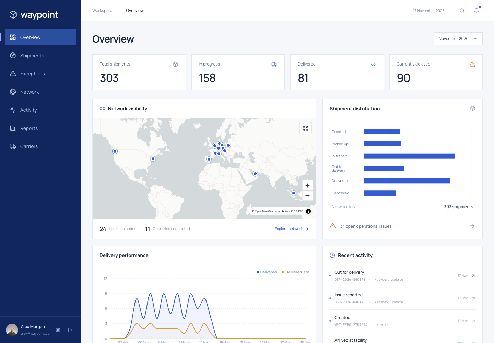
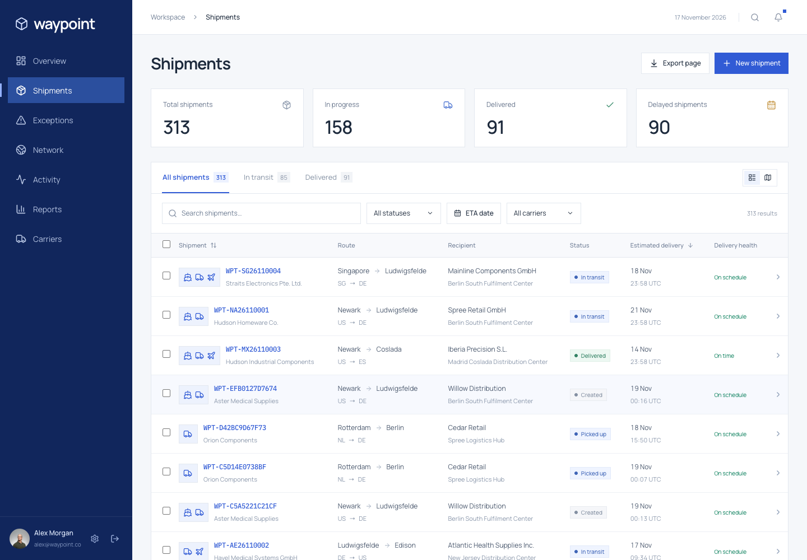
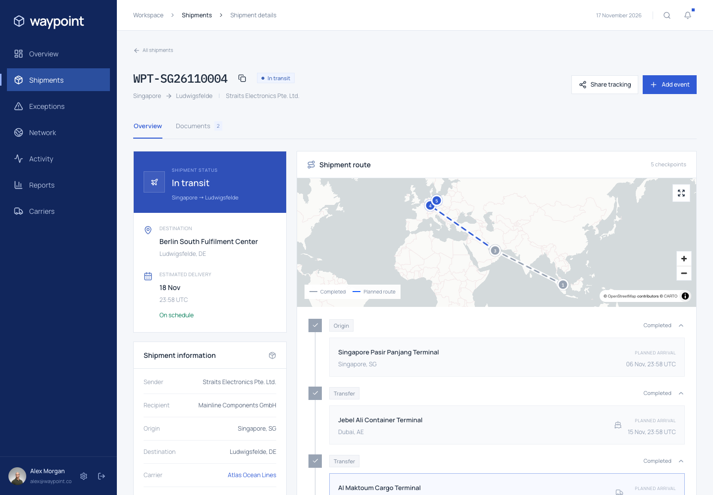
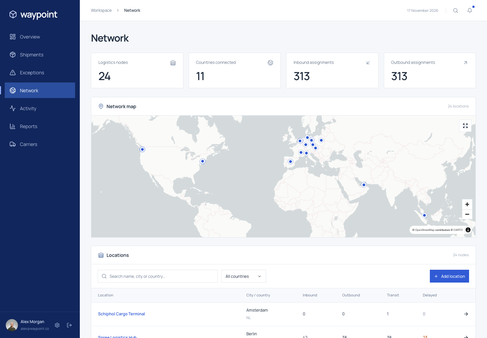
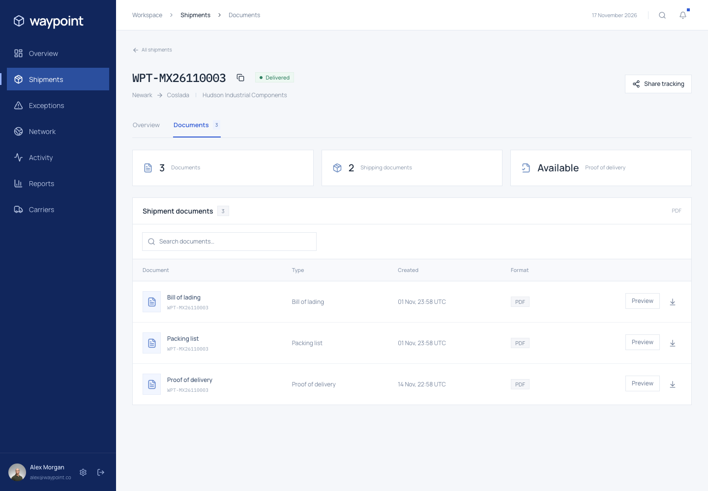
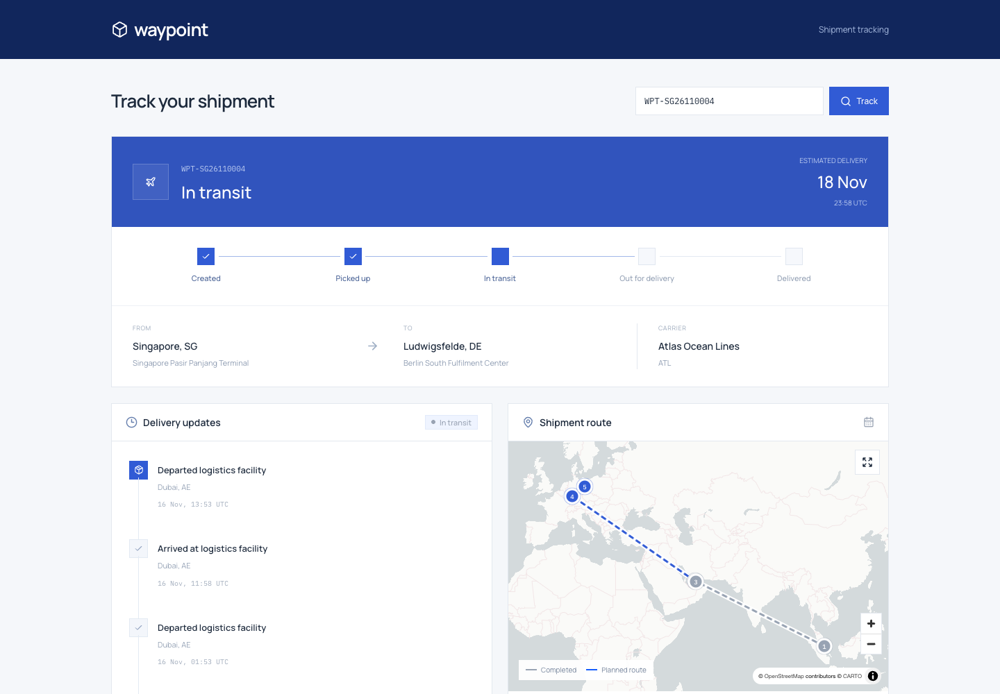

# Waypoint

Shipment operations from a planned route to the final delivery document.

 · [Watch walkthrough](artifacts/portfolio/demo.mp4)

## Follow the shipment, not a collection of disconnected screens

The shipment registry is the starting point. Open a record to follow its multimodal checkpoints, events, exceptions and documents. Network, carrier and reporting views lead back to the same shipments.

Create a route across road, ocean, air or rail legs, record operational events and resolve issues as the shipment progresses. Recipient tracking shares the delivery view separately from internal operations.

- **Operations:** shipment search, filters, route creation and an event journal.
- **Routes:** ordered checkpoints, transport modes and map-based route views.
- **Exceptions:** an issue queue with resolution history and shipment context.
- **Network:** facility activity, carrier profiles and linked shipment records.
- **Documents:** shipment PDF preview and download, including delivery evidence.
- **Reporting:** monthly performance, lane analytics and customer-facing tracking.

English, Spanish and German interfaces; responsive shipment, map and recipient views.

## From registry to delivery

Shipment registry and route details

Network and documents

Recipient tracking

## Built with

React 19, TypeScript, Vite, shadcn/ui, Tailwind CSS and MapLibre. Express, Prisma and PostgreSQL power the application API; PDFKit generates documents.

## Demo

Interactive demo coming soon.
